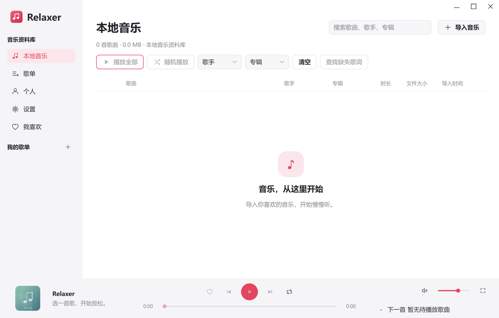

# Relaxer

[简体中文](README.md) · **English**

A quiet place for your local music. Relaxer is a Windows music player built with C++17, Qt 6, and QML, with a local library, playlists, a playback queue, synced lyrics, and customizable themes.

[Download the latest version](https://github.com/QUEQIAN1961/Relaxer/releases/tag/v0.2.1-GA) · [All releases](https://github.com/QUEQIAN1961/Relaxer/releases) · [Report an issue](https://github.com/QUEQIAN1961/Relaxer/issues)



## Downloads

Ready-to-run packages are available for **Windows x64**. Dependencies are bundled; you do not need a Qt installation or development environment.

| Version | Interface | Windows download | Source | Release notes |
| --- | --- | --- | --- | --- |
| **0.2.1-GA · Recommended** | QML by default; Widgets compatibility mode | [Win64 ZIP](https://github.com/QUEQIAN1961/Relaxer/releases/download/v0.2.1-GA/Relaxer-V0.2.1-GA-Win64.zip) | [Source ZIP](https://github.com/QUEQIAN1961/Relaxer/releases/download/v0.2.1-GA/Relaxer-V0.2.1-GA-Source.zip) | [Release notes](docs/releases/v0.2.1-GA/RELEASE-NOTES-V0.2.1-GA.md) |
| 0.2.1 · Previous stable version | QML by default; Widgets compatibility mode | [Win64 ZIP](https://github.com/QUEQIAN1961/Relaxer/releases/download/v0.2.1/Relaxer-V0.2.1-Win64.zip) | [Source ZIP](https://github.com/QUEQIAN1961/Relaxer/releases/download/v0.2.1/Relaxer-V0.2.1-Source.zip) | [Release notes](docs/releases/v0.2.1/RELEASE-NOTES-V0.2.1.md) |
| 0.2.0-GA · Previous stable version | Widgets | [Win64 Portable ZIP](https://github.com/QUEQIAN1961/Relaxer/releases/download/v0.2.0-GA/Relaxer-V0.2.0-GA-Win64.zip) | [Source ZIP](https://github.com/QUEQIAN1961/Relaxer/releases/download/v0.2.0-GA/Relaxer-V0.2.0-GA-Source.zip) | [Release notes](docs/releases/v0.2.0-GA/V0.2.0-GA-ReleaseNotes.md) |
| 0.2.0-rc2 · Historical prerelease | Widgets | [Win64 ZIP](https://github.com/QUEQIAN1961/Relaxer/releases/download/v0.2.0-rc2/Relaxer-V0.2.0-rc2-win64.zip) | [Source ZIP](https://github.com/QUEQIAN1961/Relaxer/releases/download/v0.2.0-rc2/Relaxer-V0.2.0-rc2-foundation-src.zip) | [Release notes](docs/releases/v0.2.0-rc2/V0.2.0-RC2-ReleaseNotes.md) |

The four release entries above include three stable versions and the historical RC2 prerelease. Their documentation is grouped under [`docs/releases/`](docs/releases/). Current application source is in `src/`.

Each release includes `SHA256SUMS.txt`. GitHub's automatic Source code archives contain source, not a ready-to-run Windows application.

## Getting started

1. Download a Win64 ZIP and **extract the entire archive into a new writable folder**.
2. Double-click **`RelaxerStart.exe`** and import your local music.
3. Keep the full directory structure. Do not run from inside the ZIP or move the EXE on its own.

Version 0.2.1-GA starts the QML interface by default. `RelaxerQml.cmd` remains available. To use the Widgets interface:

```powershell
.\RelaxerStart.exe --widgets
```

Local playback works offline. Online lyrics and translation require a network connection. AI translation uses your provider configuration and requires explicit confirmation for paid requests.

0.2.1-GA fixes duplicate playlist creation, adds a larger playlist cover with a smooth collapsing header, and removes the extra fullscreen button from the expanded player. See the [release notes](docs/releases/v0.2.1-GA/RELEASE-NOTES-V0.2.1-GA.md).

## Features

- Local music imports, library management, playlists, favorites, a playback queue, and saved playback state.
- Synced lyrics, bilingual display, timing offsets, lyric search and previews, and manual lyric imports.
- Expanded and fullscreen playback, plus the Widgets compatibility interface.
- Palette and image themes, font settings, text and progress colors, and separate blur controls for the left panel, right panel, footer, and expanded player.
- Optional lyric translation using your own provider configuration and credentials.

## Upgrading from 0.2.0-GA or 0.2.1

Exit the old application completely and back up the entire `data` folder. Place a **copy** of that folder beside the new launcher as `data`. Keep the original backup and do not let both versions write to the same data directory. Existing library, playlist, lyric, and settings storage is retained. See the [0.2.1-GA release notes](docs/releases/v0.2.1-GA/RELEASE-NOTES-V0.2.1-GA.md). Existing duplicate playlists are left for you to manage.

## Verify a download

```powershell
Get-FileHash .\Relaxer-V0.2.1-GA-Win64.zip -Algorithm SHA256
```

Compare the result with `SHA256SUMS.txt` from the same release.

## Building from source

Use Windows, MSYS2 UCRT64, C++17, CMake 3.22+, Ninja, and matching Qt 6 Core/Gui/Widgets/Sql/Multimedia/Svg/Network/Qml/Quick/QuickControls2 packages. Tests also require Qt Test.

```powershell
git clone https://github.com/QUEQIAN1961/Relaxer.git
cd Relaxer
cmake -S . -B build -G Ninja -DCMAKE_BUILD_TYPE=Release -DCMAKE_PREFIX_PATH=C:/msys64/ucrt64
cmake --build build --target Relaxer RelaxerStart --parallel
```

If Declarative uses a separate prefix, add `-DQT_ADDITIONAL_PACKAGES_PREFIX_PATH=<matching-prefix>`. See `scripts/` for dependency and deployment tools. The source-root bootstrap launchers support building from source; use the full Win64 release package for normal use. To reproduce a published version, check out its release tag before building.

## Releases and verification

Version 0.2.1-GA integrates the playlist fixes manually accepted by the user, followed by a fresh build with the GA label, scoped developer regression tests, and native package verification. This GA patch has no new independent Harness verdict.

The historical 0.2.1 Windows download preserves the build tested by the user and independently checked by Harness, built from `eb3027eed47109ab300047e8fc2d0fbe0246081a`. Version 0.2.0-GA retains its historical stable build. Each release documents its provenance, hashes, and verification scope.

Online services, all hardware/codec combinations, and long-running playback have not been exhaustively verified. Include the version, Windows environment, reproduction steps, and redacted logs in issue reports. Do not attach API keys, personal databases, or music files.

## License and acknowledgments

Relaxer-authored code is licensed under **GPL-3.0-only**; see [LICENSE](LICENSE) and [ABOUT.md](ABOUT.md) for an introduction. Qt, FFmpeg, OpenCC, compiler runtimes, and other dependencies retain their own licenses and copyright notices. See [THIRD_PARTY_NOTICES.md](THIRD_PARTY_NOTICES.md) and the license directories in the release packages.
