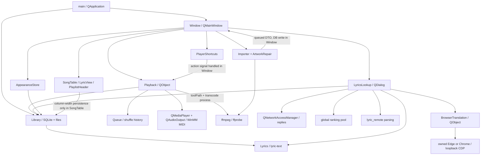

# 当前架构依赖分析

## 1. 分析方法和构建事实

本分析核对了类声明、函数实现、信号连接、数据库 SQL、后台任务创建和析构路径；不以文件名判断职责。函数位置以受验收基线为准，Phase A 没有修改 `src/`。

当前 CMake 只有两个主要播放器库：

- `relaxer_core`：`library/importer/lyrics/lyric-text/playback`，链接 Qt Core、Gui、Sql、Multimedia，Windows 另链接 winmm。**没有 Qt Widgets 依赖，但也不是不依赖 Qt 的纯 C++ 核心。**
- `relaxer_ui`：界面、歌词搜索、浏览器翻译、远程歌词协议、主题、快捷键等共用静态库，链接 `relaxer_core`、Widgets、Svg、Network，Windows 另有 user32/dwmapi。
- `Relaxer` 入口组装 `Library` 和 `Window`。`RelaxerStart`、`RelaxerLockCheck` 是独立 Win32/标准 C++ 可执行程序，不依赖播放器 Widgets 库。
- 没有 Qt Quick/QML 构建目标，本阶段也没有引入它们。

证据：[CMakeLists.txt](C:/Users/email/Desktop/Relaxer/Relaxer-V0.2.0-dev/CMakeLists.txt)、[main.cpp](C:/Users/email/Desktop/Relaxer/Relaxer-V0.2.0-dev/src/main.cpp)。机器生成的直接 include 列表在 `evidence/include-map.json`；它不等价于运行时对象依赖，以下关系还核对了实际调用。

## 2. 当前对象与调用关系

图中的导入结果返回关系表示信号及主线程插库，不表示工作线程直接调用 `Window` 的 UI 方法。

## 3. 模块逐项结论

| 模块 | 实际职责、依赖和状态归属 | 证据 |
| --- | --- | --- |
| 播放引擎 | `Playback` 维护当前队列、Session、加载/自动播放标志、错误跳过、恢复进度和统计采样；`playing()` 读 QMediaPlayer 或 MIDI 状态。`Queue` 管理顺序/循环/随机袋和历史。转码缓存和 MIDI 与普通播放同处一类 | `playback.h/.cpp`：`load/play/toggle/seek/sample/save/restore/ensurePlayable/startMidi` |
| 曲库与数据库 | `Library` 同时负责 SQLite 查询、歌单成员、播放统计、通用设置、封面文件、歌词文件和歌词缓存。持有唯一命名连接，非抽象仓库接口 | `library.cpp`：`open/tracks/insert/saveSession/saveLyrics/removeManaged` |
| 播放列表 | 保存的歌单成员/顺序在 `playlist_tracks`；计数和播放总数由 JOIN 聚合得到。`PlaylistHeader` 是展示组件；`Window` 收集选择、确认并调用 Library 写入 | `Library::playlists/addToPlaylist/reorder`；`Window::reorder/createPlaylist/removeFromPlaylist`；`playlist-ui.*` |
| 歌词检索与匹配 | `LyricsLookup` 同时负责选区/筛选、查询计划、多来源请求、重试预算、候选评分、自动接受策略、缓存与保存。匹配虽有静态函数，仍声明在 QDialog 类中 | `lyricslookup.cpp`：`beginOnline/pumpQueries/request/computeRank/applyRanking/applyAccept/matchScore/confident` |
| 远程歌词协议 | `lyric_remote::begin/consume` 把来源协议转换为下一请求或候选记录，不执行网络请求，不需要 QWidget | `lyric-remote.h/.cpp` |
| 歌词翻译 | `BrowserTranslation` 自身只依赖 Qt Core/Network，管理独立浏览器、CDP、网页读取、内存缓存和暂停恢复；整首队列、选区、进度、保存仍在 LyricsLookup | `browser-translation.*`；`LyricsLookup::enqueueTranslation/translateStep/finishTranslation` |
| 歌词文件及时间轴 | `Lyrics::parse/indexAt` 和 `lyric-text` 是无 Widgets 的值处理；文件写入主要在 Library。`Window::refreshTrack` 仍直接读文件、解析、读延时并更新显示；LyricView 还负责同时间戳原译分组和高亮 | `lyrics.*`、`lyric-text.*`、`library.cpp:457`、`window.cpp:1055`、`widgets.cpp:616` |
| 设置与主题 | 大部分用户设置经 Library 写 SQLite JSON，AppearanceStore 管理主题历史及图片；同一头文件/实现又包含 Surface 和 AppearancePage，使 Store 的编译与链接牵连 Widgets。Window 负责最终调色板、系统主题及预览应用 | `Library::setting/setSettings`；`AppearanceStore::state/save/use`；`Window::applyTheme`；`appearance.*` |
| Widgets UI | Window 组装全部页面，还编排导入和封面修复、歌词加载、播放保存定时器、通知与快捷键动作。SongTable 是 QTableWidget，NextQueuePanel 接收播放预测快照，LyricTools 管交互与延时控件 | `window.*`、`widgets.*`、`nextqueue.*`、`lyric-tools.*`、`shortcuts.*` |
| Win32 首次准备 | 启动选择、准备状态机、系统主题、依赖检查/更新/编译/测试/收集/验证/清理以及最终进程启动；与播放器模块独立 | `start-windows.cpp`、`launch-plan.h`、`prepare-flow/progress/window/theme.h`、`scripts/*` |

## 4. 七项重点检查

### 4.1 业务是否依赖 QWidget 或具体窗口

依赖分为三种，不能统称为“核心全都绑在界面上”：

1. `Library/Playback/Importer/Lyrics/lyric-text` 不依赖 QWidget，已经可由非 Widgets 调用者使用；但仍依赖 Qt，以及部分 Gui 图像和 Multimedia 能力。
2. `BrowserTranslation`、`lyric_remote` 也没有 Widget 对象依赖，只是当前归入 UI 构建目标，可先做构建边界抽离。
3. `LyricsLookup` 的搜索与翻译编排实际依赖 `QListWidget` 行、勾选框、窗口状态和确认框；`Window` 的导入编排也依赖页面控件。`AppearanceStore` 本身不需要具体窗口，但头文件/TU 与 QWidget 页面混合；`PlayerShortcuts` 需要 QWidget 和本地快捷键上下文。

因此，Phase B 的重点应是服务编排和编译依赖边界，而不是重写已经独立的播放后端。

### 4.2 播放状态是否直接由界面维护

主状态在 Playback：`m_queue/m_session/m_loading/m_autoStart`，实际播放状态读媒体后端。`Window` 通过 `trackChanged/stateChanged/positionChanged` 刷新按钮与歌词，不是唯一播放状态源。

仍有泄漏：`Playback::media()` 暴露可变 `QMediaPlayer*`，Window 直接订阅其 `seekableChanged`；保存队列的 4 秒定时器由 Window 创建。UI 还有 `m_playerExpanded/m_lastQueueMode/m_motionRevision`，分别属于显示状态或快照，不应误移成播放引擎状态。

证据：`window.cpp:198` 信号连接，`window.cpp:281` 恢复及保存定时器；`playback.cpp:387` 队列设置持久化。

### 4.3 曲库、歌单与播放队列是否有重复状态

- Library 的 SQLite 是歌曲和保存歌单的权威存储；没有另一个歌单业务仓库。
- `Queue.items/index/bag/history` 是播放队列和随机历史，**不是已保存歌单的副本状态错误**。删除歌单不应自动等价于清空当前播放队列。
- SongTable、NextQueuePanel、歌词候选哈希及 Window 的筛选域都是可刷新快照。后续要规定刷新来源，不应把所有快照都消灭。
- `tracks.plays/heard` 与 Session 明细存在有意的统计冗余，由 `Library::saveSession()` 在同一事务内更新；不可随意改成前端累加。
- `Window::visibleTracks()` 还含歌手/专辑过滤策略，应在新前端接入前形成独立查询输入，避免两个 UI 各自重写规则。

### 4.4 歌词搜索与翻译能否脱离 UI

远程协议解析、文本处理和单行 BrowserTranslation 可以；现成的整套搜索/整首翻译服务还不能。搜索任务的 `Job`、评分快照、token/generation 已提供可拆分基础，但控制流仍读写窗口成员。仅移文件或更名不算完成解耦。

适合先抽取无副作用匹配策略，保留 `LyricsLookup` 静态兼容入口；再把任务状态改成按歌曲 ID、任务 ID 发出的 DTO/信号，最后让窗口只提供选择与确认。

### 4.5 后台任务生命周期

| 任务 | 当前创建/拥有者 | 取消、回收及需保留的契约 |
| --- | --- | --- |
| 播放、转码、统计采样 | Playback，QObject 子对象及 QTimer | 析构保存、停止媒体、终止自己的转码；generation 和歌曲 ID 防止旧转码接管新曲目 |
| 导入 | Window 创建 QThread + Importer；Importer 内部局部 QThreadPool | 原子 cancel，任务池结束后发 finished，线程 quit/deleteLater；Window 析构 cancel + wait。结果在 Window 所在线程写 DB |
| 封面修复 | Window 创建 QThread + ArtworkRepair | 原子取消，结果回主线程后按旧封面/歌曲哈希验证再应用；析构等待线程 |
| 歌词请求与内嵌探测 | LyricsLookup 的 QNetworkAccessManager、reply、Job、QProcess | `live/cancelJob/stop`、超时和容量限制；关闭窗口使结果失效 |
| 候选评分 | 进程级静态 QThreadPool，捕获值快照及 Job 共享指针 | QPointer 防窗口销毁，返回时校验 generation/hash/epoch；aboutToQuit 设置全局取消。关闭窗口不是立刻终止所有计算 |
| 系统代理发现 | LyricsLookup 构造时 detached std::thread | QPointer 和原子状态防回调写失效窗口；任务本身无统一 join，也不能假设移出窗口即可自然完成回收 |
| 翻译浏览器 | LyricsLookup 拥有 BrowserTranslation；后者拥有 QProcess/socket/timer/lock | token、内部 epoch、等待验证；对象析构关闭自己配置下浏览器，不附加个人会话 |
| 首次准备 | PrepareWindow 管工作线程，Win32 capture 管子进程 | 准备窗口/状态快照、进程超时、句柄回收及受管缓存归属检查；与 Qt 应用任务分开 |

不能把 Library 的 QSqlDatabase 对象直接搬进任意工作线程。当前连接由创建/打开它的线程使用；未来异步存储必须明确队列或每线程连接，Phase B 初期应继续保持现有主线程提交路径。

### 4.6 数据库和配置能否长期兼容

可以先保留 Library 作为兼容门面，但尚不是完整的长期版本化协议：

- `open()` 设置外键、WAL、busy_timeout，按列存在性做兼容迁移；当前没有独立 schema 版本/迁移账本。
- 设置值编码为单元素 JSON 数组，例如 `theme` 的 `[2]`。键名、类型、缺省值及未知键保留属于兼容契约，不能换 UI 时重置。
- 歌单顺序保存在 `position`；文件相对路径、歌曲 ID、hash、Session 统计和歌词缓存有效期需保持。
- 文件歌词的 `[offset:]` 与 `lyrics_playback.offset_ms` 是两种不同偏移；计时双语按重复时间戳对应，普通双语靠 `relaxer-bilingual` 标记。
- `saveLyrics()` 使用 QSaveFile，但文件提交与后面的 SQL 更新不是一个跨资源事务；`updateLyrics()` 直接复制输入，与 saveLyrics 的简繁转换路径也不同。这里应先测试和记录，不能在重构中顺手统一语义。
- 设置 API 返回 QJsonValue，类型验证分散；部分 qint64 ID 经 JSON double 保存，未来 QML 边界要明确精度策略，但本阶段不改变存储格式。
- 通用 `setSetting()` 不自动广播统一配置变更；目前调用者主动刷新外观。新设置服务要先保持此时序，再设计通知。

### 4.7 可保持外部行为抽离的模块

优先：BrowserTranslation 和远程协议的构建目标；Queue 的现有实现；歌词文本/时间轴值对象；匹配策略静态函数；AppearanceStore 与页面的头文件/TU 分离。

随后：围绕现有 Library 建薄的设置/歌词存储门面、导入协调器、整首翻译协调器。最后再抽取多来源歌词搜索调度。播放引擎已经不依赖 Widgets，应保持实现稳定，只补齐清晰的 QObject 接口，避免重新设计播放链路。

## 5. 独立启动流程的实际边界

`launch-plan.h::select()` 优先检查 runtime EXE 和 ready 标记是否存在；存在时直接走 Portable。它**没有比较源码指纹**。内容指纹由 CMake 配置时生成，解决已经触发构建之后的时间戳/旧对象复用问题，不代表双击启动器必然重编译新改过的源码。

因此，后续开发须显式配置和构建；需要体验新播放器时再按受控流程收集、验证并部署 runtime。不要用“原 runtime 能启动”替代“新代码已部署”的证据。

另一个已核对的历史问题：`verify-runtime.ps1` 写入的 proof.version 固定为 `1.5.0`，而产品是 `1.10.0`；上一轮本地部署脚本做过修正。本轮隔离验证不覆盖原 proof，也没有为了整理架构改动该脚本。此项作为后续独立工程修复议题，不和核心解耦合并。

## 6. 风险与优先级

| 风险 | 影响 | 建议处理阶段 |
| --- | --- | --- |
| UI 行号/状态文字与任务调度绑定 | 窗口迁移后候选或旧译文可能写错歌曲 | Phase B 后段，先冻结 ID/token 契约 |
| SQLite 线程归属与文件/DB 双资源写入 | 并发错误、部分提交、资料兼容性 | 全程保持现有连接策略，事务改善另立变更 |
| Queue::upcoming 会缓存后续随机袋 | 改成看似纯 const 查询可能改变下一首 | Queue 抽离必须原样迁移并验证预测一致 |
| Window 析构与全局评分池/代理线程 | 提前销毁、退出阻塞或回调时序变化 | 显式生命周期设计及取消测试后再迁移 |
| 浏览器 DOM 和服务限流 | 网站改版/验证码导致翻译等待 | 在线人工验收独立于默认 CTest |
| 直接暴露 QMediaPlayer 与 WinMM 单 alias | 双前端控制不一致、重建后端打断播放 | 增量适配接口，不替换后端 |
| 主题策略与 QWidget 文件混合 | 新 UI 被迫依赖旧 UI 库 | 先拆 Store/策略，图像处理仍允许 QtGui |
| 启动选择和 proof 版本的历史差异 | 用旧 runtime 误验新源码 | 开发流程明确标记，另开启动工程议题 |

这些是代码审查发现的边界和风险，不等于用户已验收功能出现回归；Phase A 没有据此更改产品行为。
