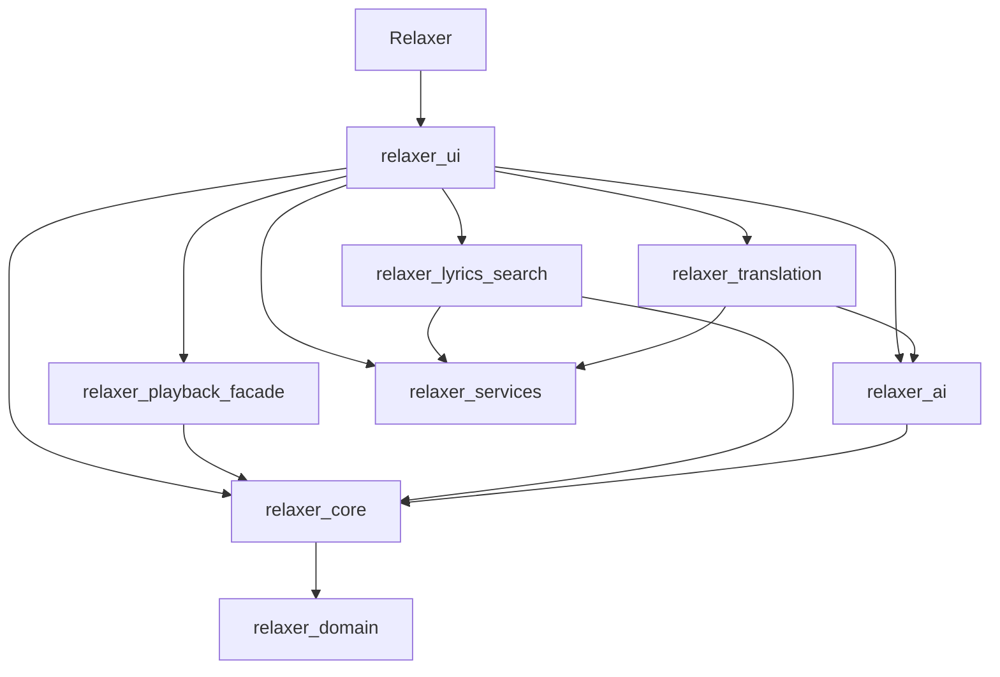

# Phase B 最终集成契约

基线：B9 R8 PASS，Commit `6bd1910f4ce7ae768ff38aa9d162d4f016f2ea16`、Tree `fbf1b3e1698830b2afe333ee3c4973106d1c42f1`。本分支用于 `V0.2.0-rc1`，等待 Harness R9；不是 Phase B10、Phase C 或正式发布。

## 实际目标依赖

Domain只依赖Qt Core。core按历史组织包含Library/Settings/Appearance、Importer/ImportCoordinator、歌词解析/读取、Playback，并继承Gui/Sql/Multimedia依赖；它并非纯Domain。services含远程歌词和浏览器翻译；Widgets只在UI层。PlaybackSnapshot实际位于门面头文件，使用媒体枚举，没有为目录外观移动至Domain。

Playback是唯一播放/Queue/会话/统计权威；Facade转发并拥有单一4秒保存timer。Library是数据库权威，导入worker只交换路径/DTO与取消token，提交在Library线程。TranslationCoordinator与LyricsSearchCoordinator分别拥有task/generation，歌词窗口只保存前端身份。没有新增数据库或AI请求权威。

## 新测试

- `relaxer_phase_b_integration`：播放与搜索、播放自动推进与AI预览、搜索/翻译筛选取消保存重选、导入/重复/歌单/屏障取消、20曲+20曲并发、D-R8-01、1000曲/100次切歌/100次Facade生命周期。
- `relaxer_phase_b_storage`：真实历史初始化SQL、旧数据重开与暂停恢复、未知JSON/主题/AI/歌词缓存、ABORT/BUSY/只读连接、退出保存失败现有契约、外部歌词修改/数据库拒绝/Windows独占文件锁。
- 历史夹具位于 `tests/fixtures/phase-b-legacy-sql.json`，包含真实Commit和Library::open摘要。没有虚构schema版本；两代实际初始化逻辑相同。

所有测试使用合成音频、临时SQLite、localhost HTTP和假凭据。并发用QSemaphore、HTTP hold/release、QSignalSpy/QTRY形成屏障，没有随机sleep制造竞争。物理听音、真实MIDI硬件、一小时稳定性和突然断电须单独记录。

## 变更范围

D-R8-01只以QSignalBlocker恢复按钮checked，预览/任务不丢失；保留修复前失败日志。D-R8-02先复现并形成方案，不新增退出模态交互。D-R8-03继续延期；Queue、Playback、Library、统计、搜索评分和AI Provider/请求边界不改。

版本数值字段0.2.0、界面/发布元数据rc1，Windows合法数字0,2,0,0且带预发布标志。应用名称/组织仍为Relaxer，dataRoot函数原样；历史更新日志和ready证明协议1.5.0保留。
