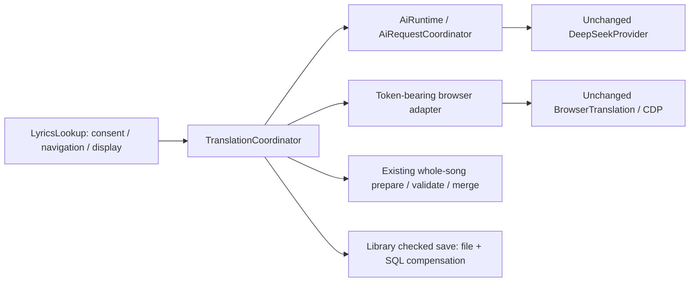
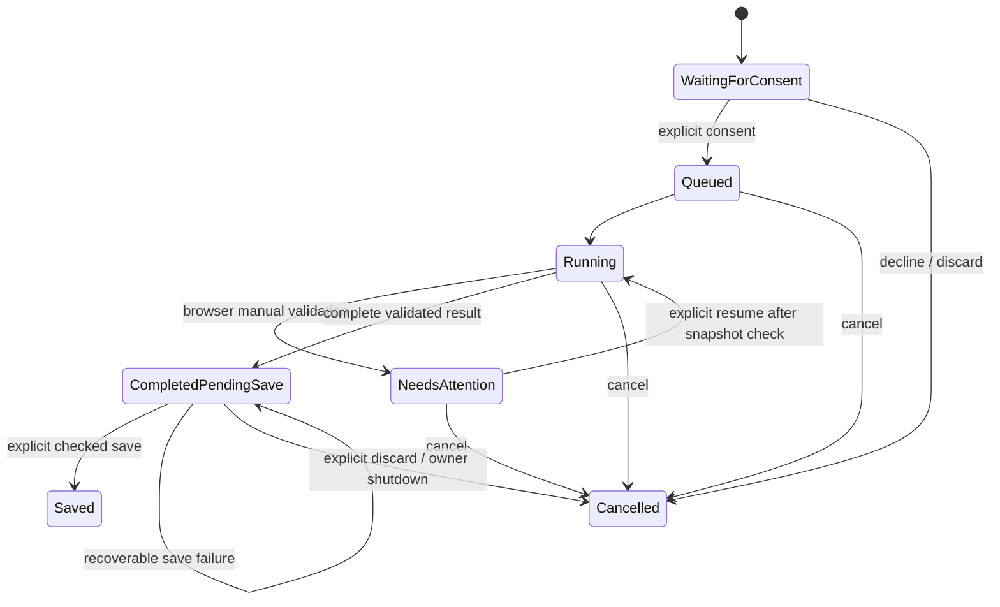

# Phase B7 TranslationCoordinator

Frozen behavior and baseline facts: [b7-contracts.md](b7-contracts.md).

`LyricsLookup` now keeps only a business task ID plus modal-consent reentrancy.
It maps track IDs to visible rows, renders summaries and forwards explicit decisions.
It no longer owns request IDs, source/configuration snapshots, result validation,
merged bytes or the saving lifecycle. Filtering and the R5.1 audit are unchanged.

## State and identity

Preparation creates `WaitingForConsent` without any network dispatch. Only an
explicit `start(taskId)` enqueues it. A bounded FIFO serializes work within one
coordinator; independent windows retain independent coordinators and can share
AiRuntime. The coordinator stores at most 32 live/retained tasks. `forget` accepts
only terminal tasks; the Widgets adapter retires them on explicit discard/resend.

`Failed` and `Invalidated` are terminal exits for backend/validation errors and
stale source/configuration respectively. Every terminal transition publishes one
`finished` event while the service/event loop is alive. A completed preview is
not terminal until saved, explicitly discarded or invalidated. `cancel` after
completion returns false and retains the preview; `discard` is a separate command.
Deferred notifications use QObject context and disappear safely on destruction.
Consumers should not expect delivery after destroying the receiver/service.

Task IDs and browser segment tokens are process-wide unique monotonic values.
Each task also has a coordinator generation. AI request IDs remain solely owned
by AiRequestCoordinator; only the active task's exact request ID can deliver.
Browser callbacks carry exact segment tokens. Duplicate completion/attention/
resume and callbacks from retired tasks cannot change the active task.

## Source and save protection

Preparation captures real file bytes, SHA-256, numbered effective lines and their
local timeline, track ID/hash/title/artist/path, target/configuration identity and
the existing Library source/target save snapshot. Dispatch, completion and save
recheck it. Source bytes determine merging; UI selection never determines the
destination. No secrets are put in these values. Summary text is local preview
data, and should not be logged.

`saveLyricsChecked(..., preserveText=true)` is the sole writer. It reuses existing
file replacement, SQL transaction, repeated source checks and compensation. A
recoverable save error keeps the complete result for explicit retry without a new
request. Stale content/configuration is visibly invalidated as in the baseline.
All Library/SQLite calls remain on their owning thread; wrong-thread commands are
rejected. The service creates no threads and does not use the lyric audit pool.

## Browser compatibility

No browser UI is restored: it was removed in B5.1. The compatibility API prepares
the saved source and dispatches one existing backend call per effective line;
all lines must pass the existing strict text validator before merge/preview.
Source line IDs are local and preserve repeated timestamps/choruses. The adapter
adds tokens to attention/resume signals; the existing epoch/CDP/process/profile,
cache, website scripts and 90-second attention timeout remain unchanged.
Shutdown cancels work and destroys the owned browser through its existing bounded
close/kill sequence (up to roughly 3.1 seconds in a stalled OS/browser case).

## Verified scope

Windows Release full CTest: 47/47. QtTest: 803 passed / 0 failed / 4 existing skips.
Baseline rerun: 45/45 and 755/0/4. New service: 46 results (25 test functions,
22 data rows across 3 functions, 2 init/cleanup); 2 new Widgets functions prove
production ownership/close and declined-consent behavior. No old assertions were
removed or weakened. Standalone translation configuration: 17/17; import: 11/11.

Tests use localhost HTTP, fake credentials and a token-bearing browser mock.
No real DeepSeek calls, browser website tests, personal libraries or credentials.
External delivery reports contain raw logs, runtime checks, exact hashes and
independent bundle/source restoration results. This is developer validation;
independent Harness R6 and authorized live-service/manual quality checks remain.

Inherited limits remain: no realtime file watcher, filesystem/SQLite crash window,
the small final-check-to-rename race, synchronous local save I/O and inherited
historical P3s. Task/notification counts are bounded/tested; no separate RSS leak
profiler or >1000-song stress claim is made. No B8/B9/QML work is included.
