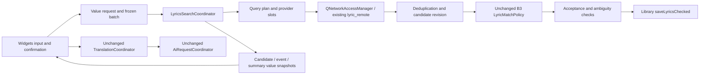

# Phase B8 LyricsSearchCoordinator

The production LyricsLookup delegates search to LyricsSearchCoordinator. The service links relaxer_core and relaxer_services, with no Widgets, Svg, Quick, Qml or AI dependency. LyricsSearchRequest carries original/match Track values, explicit manual/replace/timed choices, optional fragment and an existing checked-save snapshot. LyricsQueryPlan contains that request, budgets and provider attempts. The frontend freezes visible selected IDs before calling start; no row index enters the service.

The service owns the frozen queue, one generation per explicit start, monotonic process-wide task IDs, bounded host/song/query slots, retries and cooldowns, response parsing, local sibling/reuse/probe resolution, candidate collection, stable ranking, rank/cache epochs, cache writes, acceptance and checked automatic saves. The existing Library remains the only SQL/file authority. The service never constructs a TranslationCoordinator or AiRuntime and never dispatches paid requests.

## Production call chain

Queries preserve B7's normalized search-first order, exact get, artist aliases, lead artist, title-only/base-title/keyword/album/CJK forms, original metadata and original-credit variants, provider round-robin and backup-last behavior. Existing providers remain LRCLIB, Lyrics.ovh, NetEase, QQ and Kugou. Domestic detail insertion preserves the already-dispatched attempt prefix. Empty cache never suppresses an explicit network search. One serial second pass is reserved for incomplete first passes, not ordinary confirmed empty responses.

## Lifetime and snapshots

Queued notifications hold value copies and have a QObject context. An observer may destroy the service or start a new generation in a terminal callback. QPointer checks guard the second terminal emission. Stop invalidates the job map before aborting requests and returns cancellation snapshots so Widgets can render cancellation immediately. Every admitted or cancelled queued track has one task terminal event. Recovery keeps the same business task ID; a recovery scheduling event is not terminal. Candidate, search and R5.1 translation-assessment revisions are distinct.

Network completion is sealed before ranking/acceptance. A budget or stop cannot consume late successes; duplicate finished signals have a consumed flag and per-reply slot-release guard. Reads are capped even if downloadProgress is absent. Original identity is checked at admission, each response, rank application and save. Library additionally checks source/target SHA and transactions. HTTP transport injection supports deterministic QNetworkReply barriers; production uses the existing QNetworkAccessManager protocol.

Candidate identity is a hash of the immutable record, independent of row position or rank. UI restores the selected identity after late reordering. Collection deduplication separately includes source/native ID, artist/title/album, duration, both lyric representations and instrumental status. Provider detail IDs are retained without copying provider access keys into candidate identity. At most 100 collected and 25 displayed/cached candidates remain the B7 bounds.

Summary distinguishes candidate-bearing tracks, credible/confident tracks, policy-selected automatic acceptance, successful saves, cancellations and failures. Existing lyrics always require manual confirmation; replace only affects local resolution, never authorizes an automatic overwrite. A search response itself is not a successful save.

## Authorized R6 L-1 improvement

User explicitly authorized completed-preview close protection during B8. Independent commit df499bbfd55f402c1bddf6c765abda676a03bc8e changes only LyricsLookup and its production test suite. Running-task confirmation remains unchanged. A complete unsaved preview shows “未保存的翻译”, defaults to “取消”, and discards only after “丢弃译文并关闭”. Close, Esc/reject, save-close and accept/done share the guard. A nested close cannot create a second modal prompt. Cancel preserves preview/task/save ability; discard does not write lyrics or dispatch another request. No B7 service, AI request, validator, transaction or frozen B7 branch is modified.

R6's other P3 and disclosed limits remain inherited. The earlier frozen b8-contracts document records L-1's original behavior; this explicit authorization supersedes only that product contract. B8 remains development delivery pending independent Harness R7; B9 and QML are out of scope.

## Verification entry points

Default CTest includes relaxer_lyrics_search_coordinator and relaxer_lyrics_search_coordinator_link. RELAXER_LYRICS_SEARCH_ONLY returns before finding Widgets. Its executable import audit rejects Widgets/Svg/Quick/Qml. Existing RELAXER_TRANSLATION_ONLY and RELAXER_IMPORT_ONLY return before search targets and retain their original suite counts. All new network tests use an injected controlled transport or localhost HTTP; no public provider or paid API is contacted.
