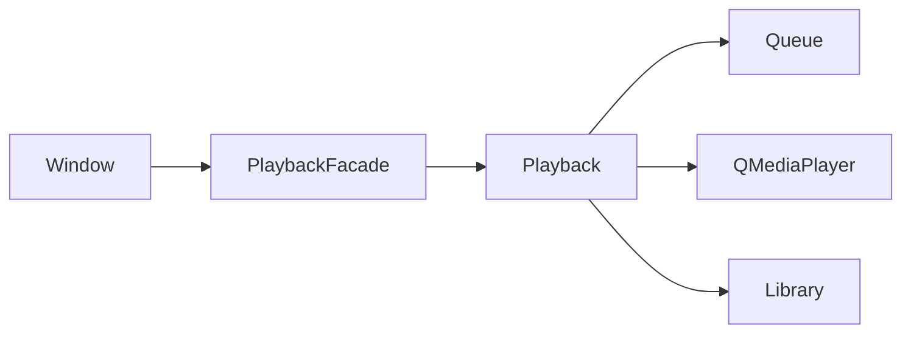

# PlaybackFacade — B9 contract

## Architecture

Before B9, Window called Playback directly, subscribed to its QMediaPlayer seekableChanged signal, and owned a periodic 4000 ms persistence timer. Window close, Window destruction, and Playback destruction each requested a final save.

After B9, Window, tray actions and existing shortcuts use one PlaybackFacade. The facade owns the existing Playback and the single 4000 ms persistence timer. Playback remains the sole authority for queue, transport, clock, MIDI, transcode and statistics. The facade stores no independently mutable playing/current/queue state. PlaybackSnapshot is a value read from Playback; snapshot() never calls Queue::upcoming(). Explicit upcoming() retains the existing shuffle forecast mutation.

## API and notifications

Facade commands wrap the existing play, toggle, next, previous, playUpcoming, seek, setMode, setVolume, forget and restore commands. No alternative playback engine or new pause/stop policy is introduced. Save returns success; shutdown is idempotent. The compatibility Window::playback() accessor returns the same owned engine for existing consumers/tests. Production Window has no media() subscription.

Snapshots include Track (with id), position, duration, playing, transport, seekable, volume, mode, Qt mediaStatus, queue ids and shutdown. Error strings remain event notifications. MIDI transport is read through Playback::transportState; Qt mediaStatus continues to describe the Qt backend.

Original track/state/position/seekable/error signals retain their synchronous timing, preserving immediate toasts and cover-animation coordination. Backend events also capture value snapshots delivered on the same QObject event loop after the engine command unwinds. Direct command snapshots are published at the command tail. Immediate deletion from the new snapshot notification is safe; existing synchronous compatibility consumers retain the normal deleteLater convention. Shutdown suppresses pending snapshots. UI queries always read the current engine state. A full regression caught and fixed two failures caused by initially delaying legacy signals; old test assertions were retained.

## Persistence and failure

Only Window's 4000 ms playback save timer moved. Playback retains its 250 ms sampling/position timer. Window retains size debounce, queue-background rendering, stats-view throttling, toast, animation and lyric display work.

Periodic save uses the existing Library::setSettings transaction to persist exactly the original queue/current/position/activeSession keys and representations. No schema or version change. Failure rolls the entire snapshot back, returns false, and emits saveFailed; a subsequent explicit/periodic save can retry. Session sampling rules, thresholds, seek disqualification and storage statistics algorithm are unchanged. A private sampleAt seam accepts controlled measured clock values for tests; production sample() supplies the actual engine clock.

Shutdown stops the persistence timer, performs one final sample/snapshot, marks the engine closed, disconnects media callbacks, invalidates delayed work, stops transport/transcode/MIDI, clears the source and detaches audio output. A failed final save is reported through saved(false)/saveFailed; the previous committed snapshot stays valid. Repeated shutdown/destruction does not retry writes after shutdown. There is no UI timer in parallel and no hidden final save in a second engine destructor.

## Ownership and ordering

| Object | Owner | Shutdown/destruction |
|---|---|---|
| Library | main stack | Outlives Window and all its services |
| Window | main stack | Stops import and facade before child destruction |
| PlaybackFacade | Window QObject child | Own timer and engine, explicit idempotent shutdown |
| Playback | Facade QObject child | Explicitly released by facade after shutdown |
| ImportCoordinator | Window child | Existing shutdown/shutdownReady waits retained |
| AiRuntime | Window child | Existing request cleanup retained |
| LyricsLookup | Scoped dialog in Window | Existing close protection and destructor cleanup |
| TranslationCoordinator / LyricsSearchCoordinator | LyricsLookup children | Existing discard/cancel and QObject context guards |
| Tray / PlayerShortcuts | Window children | UI lifetime, commands go through facade |

A new ApplicationServices container would duplicate the already explicit main-stack and QObject ownership graph; no extra container is needed. Library and facade are used on the same thread (asserted at assembly). Close-to-tray still hides without shutting down. Actual accepted close and Window destruction call the same facade shutdown. UI services are never moved to a worker thread.

## Build and compatibility

relaxer_playback_facade is a separate static library linked to existing relaxer_core; the UI links it in production. RELAXER_PLAYBACK_FACADE_ONLY enables an independent 9-test configuration. An objdump import audit requires Core/Gui/Sql/Multimedia/Test and rejects Widgets/Svg/Quick/Qml. Existing Import/Translation/Search-only counts stay unchanged.

Queue implementation, MIDI alias relaxer_midi, startMidi, ensurePlayable, cache key, providers, translation coordinator, search ranking, storage schema and Library::saveSession are protected by byte/function audit. Internal product version remains 1.10.0. Physical soundcard listening and real MIDI hardware require independent environment execution; synthetic PCM decode is separate evidence. B9 development does not constitute Harness R8 or official Phase B/V0.2.0 acceptance.

## Final development verification (2026-10-17)

Fresh Windows Release: 242/242 build actions; CTest 51/51; QtTest 927 passed / 0 failed / 4 inherited skips. PlaybackFacade 31/0/0; AI lyrics 113/0/0. Search-only 19/19, Translation-only 17/17, Import-only 11/11, Facade-only 9/9. Native deployed runtime suites: 329/0/1 (9 suites). Native original and extracted portable launches are independently recorded in delivery evidence.

The default-scale native GUI slider fixture (80 logical-pixel top-level window) reproduced a failure with the original B8 binary. QT_SCALE_FACTOR=2 avoids the Windows minimum top-level width for that fixture; all original GUI assertions then pass. Other native runtime suites use default scale. No slider code/test assertions changed. Separate normal-scale application screenshot/launch/close also passed.

NOT-EXECUTED: physical soundcard listening, real MIDI device playback, real DeepSeek/third-party online acceptance, Linux, long-duration/RSS stress. Existing synthetic MIDI import/format checks and real synthetic PCM decode passed. Zero real paid requests.
