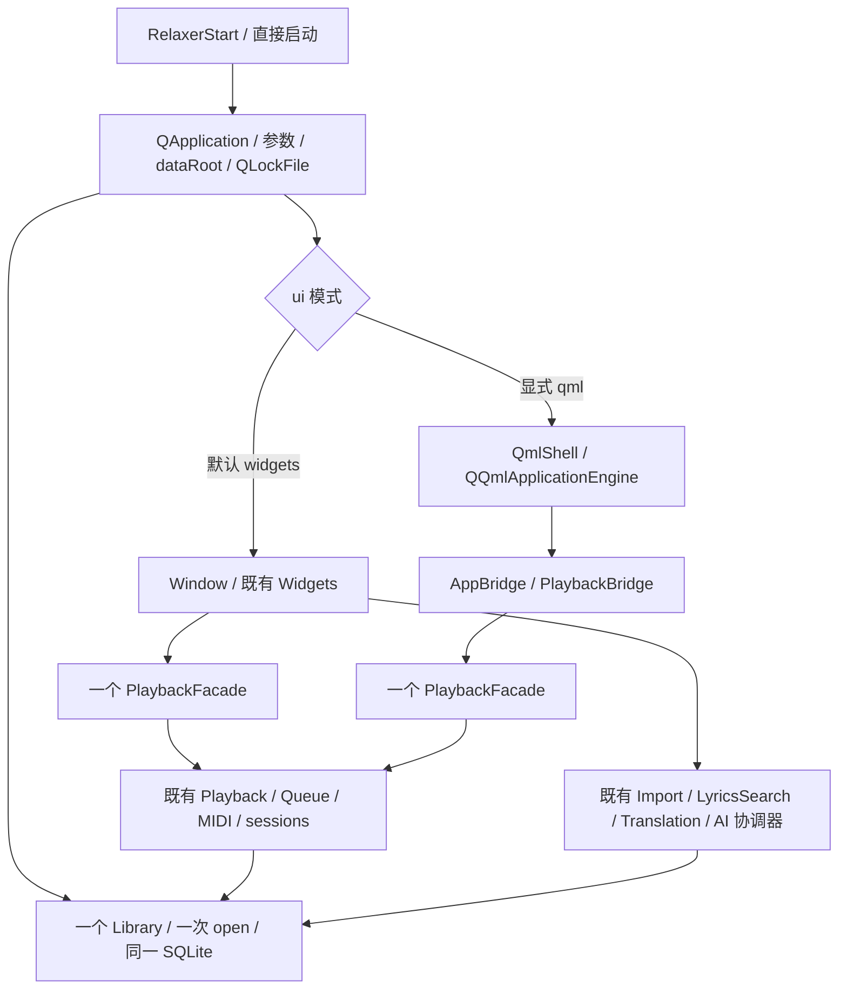

# Qt Widgets → Qt Quick/QML Migration Blueprint

## 依赖与互斥选择

图中 WF、QF 是互斥路径的实例，绝不同时创建。Library 的生命周期跨整个所选 UI；不创建隐藏 Widgets 窗口以提供 QML 状态。C1 把原 Window 所有权原样保留，在 QML 分支建立独立 UI owner，避免首次迁移就改变稳定窗口的构造/关闭语义。C2 之后如需运行时切换 UI，再评估把服务 owner 提升到应用层；C1 不支持同进程热切换。

## 风险与准入

| 风险 | 表面 | 迁移前验收 |
|---|---|---|
| 低 | 原生窗口、标题、导航、按钮、空状态、颜色/间距/字体 | QML 创建无告警、导航/键盘、DPI、tokens、明确占位 |
| 中 | 音乐/收藏/歌单模型、播放状态、进度/音量、页面切换 | typed roles、只读查询、不丢 selection、测大库；控件不得产生隐式写入 |
| 高 | 播放命令/MIDI、seek、自动下一首、统计/队列 | facade contract + 既有 MIDI/媒体/队列测试，不能新增播放器 |
| 高 | 时间同步歌词、全屏/展开动画、候选与拖排序 | 文档时间语义、过期结果丢弃、排序事务、动画销毁安全 |
| 高 | AI/付费同意、未保存预览、跨歌保护、分类持久化 | prepare/start/save 边界逐项 parity，独立 Harness；之前只用 Widgets |
| 高 | 资料持久化、异步取消、退出 | 一个数据 root/connection/engine；关闭保存错误明确；无 worker/子进程残留 |

## 节点

- **C0（本轮）**：冻结起点身份、UI/服务/数据调查、迁移风险和桥接口。
- **C1（本轮）**：可选 `--ui=qml`，官方 Quick/Controls/Qml；原生 ApplicationWindow，4 页导航、只读曲库数量/空状态、真实播放快照与已恢复歌曲的播放暂停；design tokens 和组件；专项自动测试、部署/性能基线。列表保持结构容器，歌单/设置/歌词等清楚标为未迁移。
- **C2（下一轮）**：LibraryModel / playlist read models，按需批量查询；导航/收藏/搜索/选择。先测实际大库成本再决定异步值快照或分页，SQLite 仍只在拥有线程使用。不要为查询新开第二个 Library。
- **C3**：完整 Player Interface、seek/volume/队列/统计、MIDI、详情与动画 parity。
- **C4**：LyricsDocument 模型、双语/延时/手动滚动/时间同步、展开布局。
- **C5**：设置、外观草稿、导入、搜索候选、AI 确认/预览/保存，保护优先于视觉；可再细拆。
- **C6**：大库性能、持久化/退出、完整行为对照、默认入口切换评审、Widgets 回退与 Harness。

保持原建议顺序；C1 的只读数量故意不实现完整曲目列表，避免把 C2 的全量查询/排序/角色模型和播放选择提前纳入。播放按钮仅对已有 current track 生效，没有歌曲时禁用；进度与音量先只读。普通启动继续 Widgets。正式 `v0.2.1` 标签不在本轮范围。

## 构建与交付策略

`RELAXER_ENABLE_QML` 作为 GUI 构建选项；放在四种服务配置 return 之后，使独立服务既不 find Quick 也不链接 Widgets/Quick。关闭选项时仍能构建稳定 Widgets；显式 qml 请求应说明本构建未启用。

Qt 6.11.2 已安装 Base/Multimedia/Svg，缺完整 Declarative。使用官方 MSYS2 相同版本包、核验仓库 SHA 与签名，解压到工作区 overlay，不修改已验收的系统 Qt。配置 `QT_ADDITIONAL_PACKAGES_PREFIX_PATH=<overlay>/ucrt64`；只设置 CMAKE_PREFIX_PATH 不足以覆盖 Qt 自身的受限模块查找。开发运行需同时设置 overlay/bin 的 PATH 与 share/qt6/qml 的 QML_IMPORT_PATH。Windows 包用 qmlimportscanner 扫描本地 qmldir / QML，并递归收集所有 PE 导入；在清除工具链 PATH/QML 环境的原生 Windows 会话和最终 ZIP 解压目录验证，不能仅凭构建成功认定可便携。

所有测量使用相同空 fixture、明确初始化差异、样本数/缓存状态，分别报告 load/show/first frame 和关闭；不把首次启动或空库结果泛化为大库性能。打包生成源码、完整 bundle、便携包、日志、10 份报告和 SHA256，正式交付目录保持只读。
